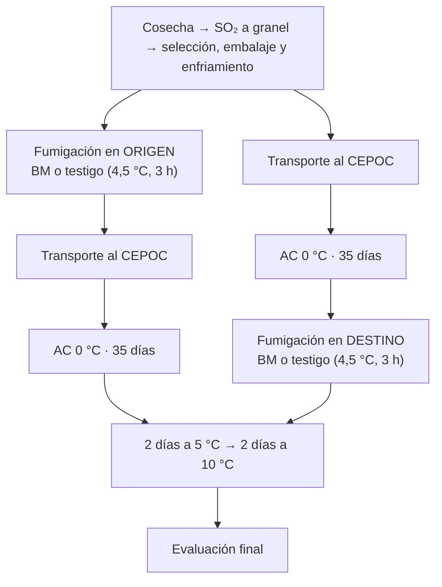

# Evaluación de postcosecha en dos cultivares de arándanos sometidos a bromuro de metilo

**Autora:** Selene Belén Segovia Gregoratti
**Programa:** Magíster en Ciencias Agropecuarias · Escuela de Postgrado, Facultad de Ciencias Agronómicas, Universidad de Chile
**Profesores patrocinantes:** Dr. Víctor Escalona · Dra. Loreto Prat
**Financiamiento:** Comité de Arándanos de Frutas de Chile
**Estado:** 🟡 Proyecto aprobado para presentación · ensayo experimental por iniciar (diciembre de 2026)

> Este repositorio reúne mi proyecto de tesis de magíster: el protocolo experimental, el plan de análisis estadístico, el código para ejecutarlo y la bibliografía que lo respalda. Lo mantengo abierto para que el trabajo sea transparente, reproducible y fácil de revisar o ampliar por otras personas.

---

## Por qué importa

Chile es uno de los principales exportadores de arándanos del hemisferio sur. En la temporada 2025/26 cerró con **92.900 t exportadas (+2,7 %)** (Frutas de Chile, 2026), y entre septiembre de 2025 y febrero de 2026 se enviaron **91.000 t por USD 460 millones FOB**, con Estados Unidos (36 %), Países Bajos (29 %) y Alemania (9 %) como principales destinos en volumen (ODEPA, 2026).

Para entrar a Estados Unidos, la fruta de áreas con *Lobesia botrana* (polilla del racimo de la vid) debe pasar por un tratamiento cuarentenario. Uno de los esquemas autorizados es la **fumigación con bromuro de metilo (BM)**: 64 g m⁻³ durante 3 h a ≥ 4,5 °C (USDA-APHIS, 2017). El BM no daña la fruta de inmediato, pero durante el almacenamiento se asocia a **ablandamiento, pudrición y degradación de la pared celular**.

La **atmósfera controlada (AC)** reduce el deterioro, pero su efecto varía entre cultivares. Y hay un vacío que este trabajo busca abordar: hasta donde pude revisar, **no hay estudios en arándano que comparen fumigar en origen vs. en destino**, algo que cambia cuánto tiempo tiene la fruta para manifestar el daño. Además, la industria está renovando sus variedades (los cultivares nuevos fueron el 24 % de las exportaciones 2025/26), por lo que entender cómo responden a estos tratamientos tiene valor práctico inmediato.


## Pregunta y objetivo

**Objetivo general.** Determinar el efecto de la fumigación con BM, aplicada en origen o en destino, sobre la calidad postcosecha de ‘Sekoya Grande’ y ‘Luna’ almacenados en AC (12 % CO₂, 6 % O₂) a 0 °C durante 35 días, seguidos de 2 días a 5 °C y 2 días a 10 °C (comercialización simulada).

**Hipótesis** (detalle en [`docs/plan-analisis-estadistico.md`](docs/plan-analisis-estadistico.md)):

1. En los testigos, ‘Sekoya Grande’ pierde menos peso y conserva más firmeza que ‘Luna’.
2. El BM reduce la firmeza y aumenta el porcentaje de frutos blandos o con pudrición respecto de su testigo.
3. El efecto del BM depende del momento de aplicación (se espera mayor en origen).
4. El efecto del BM difiere entre cultivares.

## Diseño experimental en una mirada

| Elemento | Detalle |
|---|---|
| Diseño | Completamente aleatorizado, factorial 2 × 2 × 2 |
| Factores | Cultivar (‘Sekoya Grande’, ‘Luna’) × momento (origen, destino) × BM (con, sin) |
| Unidad experimental | Caja de 1,5 kg (12 *clamshells* de 125 g) |
| Repeticiones | 3 cajas por combinación → **24 cajas** + 6 cajas de medición base |
| Condición común | SO₂ a granel (180 µL L⁻¹ h), bolsa Smartpac (0,3 % de ventilación), AC a 0 °C |
| Testigo | Mismo tiempo y temperatura de fumigación (4,5 °C, 3 h) **sin BM**, para no confundir el BM con la interrupción de la cadena de frío |
| Lugar | Centro de Estudios Postcosecha (CEPOC), Universidad de Chile, Santiago |



## Variables medidas

Calidad y condición de la fruta, medidas al final de la comercialización simulada: **pérdida de peso**, **firmeza** (FirmPro y Baxlo), **sólidos solubles totales**, **acidez titulable**, relación SST/AT, **color interno** (L\*, C\*, h°), **pruina**, **deshidratación visual** y **condición** (frutos aceptables, blandos o con pudrición). Instrumentos, unidades y fórmulas en [`docs/variables-y-metodos.md`](docs/variables-y-metodos.md); estructura de los datos en [`data/README.md`](data/README.md).

## Plan de análisis (resumen)

- Cajas como unidad experimental; **modelos lineales mixtos** (firmeza, color) y **GLMM binomiales** (proporciones de frutos) con la caja como efecto aleatorio.
- **Contrastes planificados a priori** (paquete `emmeans`) en lugar de depender de la significancia de interacciones, que con 3 cajas por combinación tienen poco poder.
- Ajuste de **Holm** dentro de cada hipótesis; variables secundarias reportadas como exploratorias.
- Se reportan diferencias con **intervalos de confianza del 95 %**, no solo valores *p*. Con 24 cajas solo se detectarían efectos grandes (≈ 1,2 DE en efectos principales y ≈ 2,4 DE en contrastes de interacción); lo menor se interpreta como tendencia.
- Cada hipótesis se clasifica por separado (apoyada · parcialmente apoyada · no concluyente · no apoyada), sin declarar la hipótesis general en bloque.

## Limitaciones que declaro de antemano

- Las fumigaciones en origen y destino ocurren en **tandas distintas**: la variación entre tandas y entre cámaras de AC no está en el error experimental, así que las conclusiones valen para las condiciones de este ensayo.
- Los cultivares provienen de **huertos distintos** (Biobío y Ñancul, Villarrica); la diferencia entre cultivares incluye el efecto del origen de la fruta.
- Se propone **repetir el ensayo en otra temporada** con tandas independientes.

## Estructura del repositorio

```
.
├── README.md
├── CONTRIBUTING.md            ← flujo de trabajo con ramas (léelo antes de abrir una rama)
├── CITATION.cff               ← cómo citar este trabajo
├── LICENSE                    ← MIT (aplica al código)
├── docs/
│   ├── protocolo-experimental.md
│   ├── variables-y-metodos.md
│   ├── plan-analisis-estadistico.md
│   ├── cronograma.md
│   ├── bibliografia.md        ← bibliografía comentada, con DOI
│   ├── glosario.md
│   └── flujo-de-ramas.md
├── data/
│   ├── README.md              ← qué va en cada carpeta y reglas de los datos
│   ├── diccionario_datos.csv
│   ├── templates/             ← plantillas de planillas de terreno/laboratorio
│   ├── design/                ← aleatorización generada por el script
│   ├── raw/                   ← datos originales (no se editan)
│   ├── processed/             ← datos limpios para el análisis
│   └── simulated/             ← datos sintéticos para probar el flujo
├── R/
│   ├── 00_aleatorizacion.R
│   ├── 01_simular_datos.R
│   └── 02_modelos_y_contrastes.R
├── results/
└── figures/
```

## Cómo reproducir el análisis

Requiere **R ≥ 4.1** y los paquetes `dplyr`, `readr`, `tidyr`, `lme4`, `lmerTest`, `emmeans` y `ggplot2`.

```r
install.packages(c("dplyr", "readr", "tidyr", "lme4", "lmerTest", "emmeans", "ggplot2"))
```

Desde la raíz del repositorio (abre `tesis-arandanos-bm.Rproj` en RStudio o fija el directorio de trabajo):

```r
source("R/00_aleatorizacion.R")        # asigna posiciones de cajas (semilla fija)
source("R/01_simular_datos.R")         # genera datos SINTÉTICOS para probar el flujo
source("R/02_modelos_y_contrastes.R")  # modelos, contrastes planificados y ajuste de Holm
```

> ⚠️ Los datos de `data/simulated/` son **sintéticos** y existen solo para validar que el código corre de principio a fin. **No representan resultados del estudio.** Cuando existan datos reales, van en `data/processed/` (mismos nombres de archivo y columnas) y se cambia `fuente <- "processed"` en el script 02.

## Trabajar con ramas

Este repositorio está pensado para que otras personas (profesores guía, colaboradores, futuros tesistas) puedan proponer cambios sin tocar la versión estable. En resumen: `main` es la versión estable y etiquetada, `develop` integra el trabajo en curso, y cada aporte vive en su propia rama (`docs/…`, `data/…`, `analisis/…`, `revision/…`, `fix/…`) que se integra mediante *pull request*. Las reglas completas están en [`CONTRIBUTING.md`](CONTRIBUTING.md) y [`docs/flujo-de-ramas.md`](docs/flujo-de-ramas.md).

## Cronograma

| 2026 | 2027 |
|---|---|
| **Dic:** presentación del proyecto, recepción de fruta, evaluación inicial | **Ene–Feb:** evaluación final · **Mar–Abr:** análisis estadístico · **Abr:** primer avance · **Abr–Jun:** redacción · **Jun:** segundo avance · **Jul:** envío de la tesis |

Detalle en [`docs/cronograma.md`](docs/cronograma.md).

## Bibliografía clave

La bibliografía completa y comentada está en [`docs/bibliografia.md`](docs/bibliografia.md). Algunas lecturas de entrada:

- Paniagua *et al.* (2013). *Moisture loss is the major cause of firmness change during postharvest storage of blueberry.* [doi:10.1016/j.postharvbio.2012.12.016](https://doi.org/10.1016/j.postharvbio.2012.12.016)
- Ortiz *et al.* (2018). *Pre-treatment with 1-MCP alleviates methyl bromide-induced decay, softening and wall degradation in blueberry.* [doi:10.1016/j.postharvbio.2018.08.018](https://doi.org/10.1016/j.postharvbio.2018.08.018)
- Forney *et al.* (2022). *Controlled atmosphere storage impacts fruit quality and flavor chemistry of five cultivars of highbush blueberry.* [doi:10.1016/j.postharvbio.2022.112073](https://doi.org/10.1016/j.postharvbio.2022.112073)
- Farneti *et al.* (2025). *Ester content of blueberry fruit can be ruled by tailored controlled atmosphere storage management.* [doi:10.1016/j.postharvbio.2024.113355](https://doi.org/10.1016/j.postharvbio.2024.113355)

## Cómo citar

Si usas este material, cítalo con la información de [`CITATION.cff`](CITATION.cff) (GitHub la muestra en el botón *Cite this repository*):

> Segovia Gregoratti, S.B. (2026). *Evaluación de postcosecha en dos cultivares de arándanos sometidos a bromuro de metilo* [Proyecto de tesis, Magíster en Ciencias Agropecuarias]. Universidad de Chile.

## Autoría, licencia y contacto

- **Autoría:** Selene Belén Segovia Gregoratti. El diseño experimental, el plan de análisis y los textos de este repositorio son de mi autoría, elaborados bajo la guía de mis profesores patrocinantes.
- **Licencia del código** (`R/`): MIT, ver [`LICENSE`](LICENSE).
- **Textos, protocolo y documentos** (`docs/`, este README): © Selene Segovia Gregoratti, todos los derechos reservados mientras no se publique la tesis. Puedes leerlos, enlazarlos y citarlos.
- **Datos:** se liberarán junto con la tesis, según las condiciones del financiamiento y de la universidad.
- **Contacto:** abre un *issue* en este repositorio.

## Agradecimientos

A los profesores Víctor Escalona y Loreto Prat por la guía del proyecto; al Centro de Estudios Postcosecha (CEPOC) de la Universidad de Chile; y al Comité de Arándanos de Frutas de Chile por el financiamiento.
