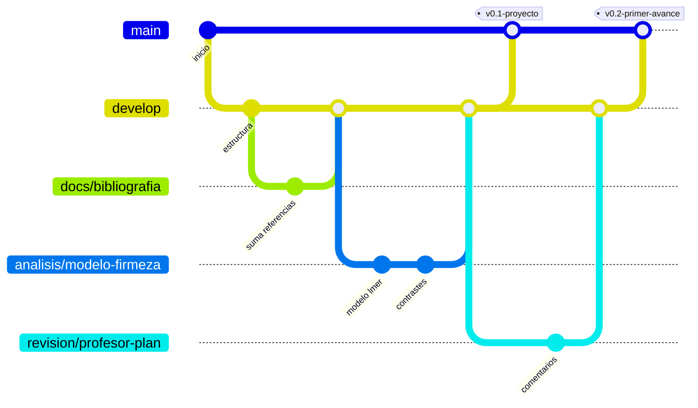

# Flujo de ramas

Resumen visual del flujo descrito en [`CONTRIBUTING.md`](../CONTRIBUTING.md).

## Hitos y etiquetas

Las versiones estables se etiquetan en `main` para poder volver a cualquier entrega.

| Etiqueta | Hito | Fecha estimada |
|---|---|---|
| `v0.1-proyecto` | Proyecto de tesis presentado | Dic 2026 |
| `v0.2-primer-avance` | Primer avance (datos y análisis preliminar) | Abr 2027 |
| `v0.3-segundo-avance` | Segundo avance (redacción en curso) | Jun 2027 |
| `v1.0-tesis` | Tesis enviada para calificación | Jul 2027 |

## Protección de ramas (configuración sugerida en GitHub)

En *Settings → Branches → Add branch ruleset* para `main` y `develop`:

- Exigir *pull request* antes de integrar.
- Exigir al menos 1 aprobación.
- Bloquear los *force push* y el borrado de la rama.

## Quién usa qué

- **Profesores y revisores:** crean `revision/<nombre>-<tema>` o comentan directamente en el PR.
- **Colaboradores y futuros tesistas:** parten de `develop` con la rama del tipo que corresponda.
- **Autora:** integra a `develop`, decide qué pasa a `main` y crea las etiquetas.
